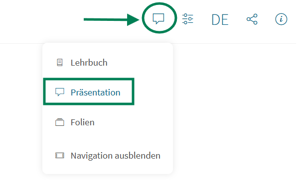
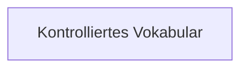
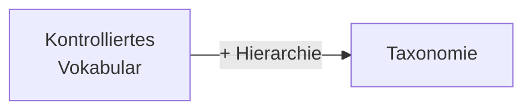
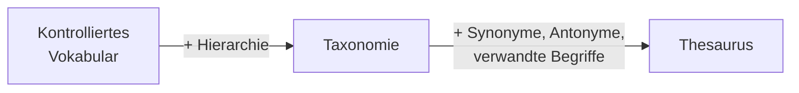
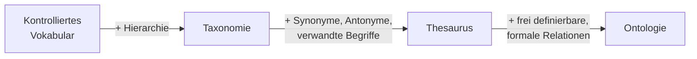

<!--
author:   Jessica Zipf

email:    Jessica.Zipf@uni-konstanz.de

version:  0.0.1

language: de

comment:  Selbstlerneinheit zu den Grundlagen des Forschungsdatenmanagements


import: https://raw.githubusercontent.com/LiaTemplates/mermaid_template/0.1.4/README.md


-->

# Vom Kontrollierten Vokabular zur Ontologie

> [!NOTE]Hinweis
> Prüfe, dass in der Menüleiste rechts oben der Präsentationsmodus (nicht Lehrbuch) ausgewählt ist.<br />
> Nur so funktionieren die enthaltenen Animationen.
> 

<h3>Selbstlerneinheit zur Vorbereitung auf den Präsenzunterricht</h3>
__ca. 20-30 Minuten__

Forschungsdaten sind nur dann auffindbar, verständlich und nachnutzbar, wenn sie **einheitlich beschrieben** werden. Dafür gibt es vier zentrale Konzepte, die in dieser Einheit im Mittelpunkt stehen:

- Kontrolliertes Vokabular
- Taxonomie
- Thesaurus
- Ontologie

**Lernziele:** Nach dieser Einheit

- kennst du die vier Begriffe und ihre Bedeutung,
- kannst du sie voneinander abgrenzen,
- kannst du für einfache Anwendungsfälle das passende Konzept auswählen.

Im Präsenzunterricht arbeiten wir darauf aufbauend an Anwendungen und Beispielen.

**So funktioniert die Einheit:** Du liest kurze Wissensbausteine, probierst Aufgaben aus und prüfst dein Verständnis mit kleinen Quizfragen. Nutze die Navigation, um durch die Kapitel zu gehen.

--------------------------------------------------------------------------------

## Problemstellung: Eine Suche, die nichts findet

### Das Problem

Eine Forscherin sucht in einem Forschungsdatenrepositorium nach Datensätzen zum Stichwort **"PKW"**. Die Suche liefert kein Ergebnis, obwohl es im Repositorium mehrere Datensätze zu **"Auto"** gibt.

Bei einer anderen Suche nach **"Bank"** erscheinen dagegen Datensätze zu Sitzgelegenheiten *und* zu Geldinstituten bunt gemischt.

### Erste Überlegung


    Woran liegt es vermutlich, dass die Suche nach "PKW" die Datensätze zu "Auto" nicht findet?

    [(X)] Für dasselbe Konzept werden unterschiedliche Begriffe verwendet, ohne dass sie einander zugeordnet sind.
    [( )] Die Datensätze zu "Auto" sind zu groß für die Suche.
    [( )] Datensätze zu "Auto" dürfen aus rechtlichen Gründen nicht gefunden werden.

      {{1}}
   Genau das ist das Grundproblem: **Dasselbe Konzept** wird mit verschiedenen Wörtern bezeichnet (Synonyme), und **dasselbe Wort** kann mehrere Bedeutungen haben (Homonyme). Ohne gemeinsame Regeln für die Begriffsverwendung bleiben Daten schwer auffindbar.

### Wie vertraut sind dir die Begriffe schon?

Überlege kurz für dich, bevor du weiterliest: Wie sicher könntest du jeweils erklären, was ein *kontrolliertes Vokabular*, *Thesaurus*, eine *Taxonomie* und eine *Ontologie* ist? Am Ende der Einheit kommst du zu dieser Frage zurück und kannst vergleichen.

--------------------------------------------------------------------------------

## Einstieg

Die vier Konzepte sind keine unabhängigen Werkzeuge, sondern bauen **Stufe für Stufe aufeinander auf**: Jedes Konzept kann mehr ausdrücken als das vorherige. Klicke dich für einen ersten Überblick durch die vier aufeinanderbauenden Stufen.

      {{1}}


      {{1}} __Kontrolliertes Vokabular__<br/>Ein kontrolliertes Vokabular legt fest, welche Begriffe erlaubt sind, und gibt jedem Begriff genau eine Bedeutung. Beziehungen zwischen den Begriffen gibt es hier noch nicht.

<br /><br />

      {{2}}


      {{2}}
      __Die Taxonomie__<br />
      Sie ordnet die Begriffe zusätzlich in einer Hierarchie an. Die einzige Beziehung ist aber die zwischen Ober- und Unterbegriff.

<br /><br />

      {{3}}



      {{3}}
      __Der Thesaurus__<br />
      Ein Thesaurus ergänzt die Hierarchie um Synonyme, Gegensätze und verwandte Begriffe. Die Beziehungstypen sind aber fest vorgegeben.

<br /><br />

      {{4}}


      {{4}}
      __Die Ontologie__<br />
      Hier lassen sich die Beziehungen frei und präzise definieren. Dadurch können auch Maschinen mit den Begriffen arbeiten und Schlüsse ziehen.

<br /><br />

{{5}}
<h4>Das große Bild </h4>
Mit jeder Stufe kommt etwas hinzu

{{5}}
```ascii
+---------------+     +-----------+     +-----------+     +-----------+
| Kontrolliertes|---->| Taxonomie |---->| Thesaurus |---->| Ontologie |
| Vokabular     |     |           |     |           |     |           |
+---------------+     +-----------+     +-----------+     +-----------+
```

{{5}}
<!-- data-sortable="false" -->
| Stufe | Konzept | Was kommt dazu? |
|:--:|---|---|
| 1 | Kontrolliertes Vokabular | eindeutige Begriffe |
| 2 | Taxonomie | + Hierarchie (Ober-/Unterbegriff) |
| 3 | Thesaurus | + Synonyme, Antonyme, verwandte Begriffe |
| 4 | Ontologie | + frei definierbare, formale Relationen |


{{5}}
Je weiter rechts, desto mehr wird aus einer **Begriffssammlung** ein **Modell des Zusammenhangs von Wissen**, das nicht nur Menschen, sondern auch Maschinen nutzen können.<br />

{{5}}
> [!IMPORTANT]**Merke:**
> Alle vier Konzepte sind Varianten desselben Grundgedankens, nämlich Begriffe eindeutig zu fassen. Sie unterscheiden sich darin, *wie viel sie über die Beziehungen zwischen den Begriffen aussagen*.

## Kontrolliertes Vobabular
Nach diesem kurzen Überblick schauen wir uns jetzt die vier Konzepte etwas detaillierter an.
### Was ist ein kontrolliertes Vokabular?

- Eine standardisierte Sammlung von Begriffen (Konzepten), deren Bedeutung **eindeutig definiert und abgegrenzt** ist
- Normierter Sprachgebrauch, bei dem **Mehrdeutigkeiten systematisch aufgelöst** werden, indem jedem Konzept genau eine Bedeutung zugeordnet ist

### Wo werden kontrollierte Vokabulare verwendet?

- Bei der Vergabe von **Schlagwörtern in Metadatenfeldern**
- Sie bilden die Basis für **Normdateien** (z. B. Gemeinsame Normdatei, GND), Klassifikationen oder Indexe

### Wofür?

- Sorgt für **Konsistenz** und hilft bei der **Verknüpfung von Informationen**
- Im Kontext von **FAIR**: zentrale Rolle, da sie Auffindbarkeit, Interoperabilität und Nachnutzbarkeit von Forschungsdaten erhöhen

### Beispiele

- [Data Documentation Initiative (DDI) Controlled Vocabularies](https://rdf-vocabulary.ddialliance.org/)
- [Liste von Sprachcodes](https://www.loc.gov/standards/iso639-2/ISO-639-2_utf-8.txt)


### Mini-Check

    Welche Aussage über kontrollierte Vokabulare trifft zu?

    [[X]] Jedem Begriff ist genau eine festgelegte Bedeutung zugeordnet.
    [[ ]] Begriffe dürfen frei und uneinheitlich verwendet werden.
    [[ ]] Es bildet automatisch Ober- und Unterbegriffe ab.


## Taxonomie
### Was ist eine Taxonomie?
- Ein kontrolliertes Vokabular, dessen Begriffe **zusätzlich hierarchisch angeordnet** sind
- Begriffe werden strikt in **Ober- und Unterkategorien** gegliedert (meist als Baumstruktur). Im Gegensatz zu Thesauri oder Ontologien fehlen assoziative Querbeziehungen oder komplexe Logiken.

### Wo werden Taxonomien verwendet?

- Zur hierarchischen **Kategorisierung von Forschungsdatensätzen in Repositorien** (z. B. nach Datentyp oder grober Fachdisziplin)
- In **disziplinspezifischen Ordnungssystemen**, nach denen Forschungsdaten grob vorsortiert werden

### Wofür?

- Erleichtert das **systematische Einordnen und Wiederfinden** von Begriffen oder Objekten durch eine klare Über-/Unterordnung
- Unterstützt das **visuelle Browsen und Navigieren** durch große Datenmengen (z. B. über Filterbäume), auch ohne konkretes Suchwort

### Beispiel

- [DFG-Fachsystematik](https://www.dfg.de/resource/blob/331944/fachsystematik-2024-2028-de.pdf) (zur Einordnung von Wissenschaftsbereichen)

### Aufgabe: Den Baum aufbauen


> [!NOTE] Ein vereinfachter Ausschnitt einer Fachsystematik.
>Erstelle eine taxonomische Hierarchie für die Fächer Psychologie und Sprachwissenschaften, indem du den jeweils nächsten Oberbegriff in die freien Felder einträgst:  
><br /><br />
> Sozial- und Verhaltenswissenschaften <br />
> Geistes- und Sozialwissenschaften <br />
> Geisteswissenschaften
> <br /><br />
> Du kannst die Begriffe einfach von hier kopieren und in das entsprechende Feld einfügen.<br />
> Ein Blick in die [DFG-Fachsystematik](https://www.dfg.de/resource/blob/331944/fachsystematik-2024-2028-de.pdf) kann dir bei dieser Aufgabe helfen.  

<!-- data-sortable="false" -->
| Begriff | Direkter Oberbegriff | Direkter Oberbegriff |
| -------- | :------: | :------: |
| Psychologie | [[Sozial- und Verhaltenswissenschaften]] | [[ Geistes- und Sozialwissenschaften ]] |
| Sprachwissenschaften | [[ Geisteswissenschaften ]] | [[ Geistes- und Sozialwissenschaften ]] |


{{1}}
In einer Taxonomie hat jeder Begriff genau **einen** Platz im Baum. Querverbindungen, etwa zwischen Sprachwissenschaften und Psychologie, kennt sie nicht.

{{1}}
<!--
style="
display: block;
width: 50%;"
-->
``` ascii
.-------------+---------------+--------.
|"             {{2}}                  "|
|"  Geistes- und Sozialwissenschaften "|
'--------------------------------------'
                   /\                  
                  /  \                 
                 /    \                
                /      \               
.-----------------.  .-----------------.
|"     {{3}}     "|  |"     {{3}}     "|
|"  Geistes-     "|  |" Sozial- und   "|
|" wissenschaften"|  |" Verhaltens-   "|
|                 |  |" wissenschaften"|
'-----------------'  '-----------------'
        |                  |           
        |                  |           
.-----------------.  .-----------------.
|"     {{4}}     "|  |"     {{4}}     "|
|"   Sprach-     "|  |" Psychologie   "|
|" wissenschaften"|  |                 |
|                 |  |                 |
'-----------------'  '-----------------'
```
### Mini-Check

    Was unterscheidet eine Taxonomie von einem einfachen kontrollierten Vokabular?

    [[X]] Die Begriffe sind zusätzlich hierarchisch in Ober- und Unterkategorien angeordnet.
    [[ ]] Die Begriffe sind nicht mehr eindeutig definiert.
    [[ ]] Es werden beliebig viele Beziehungstypen zwischen Begriffen definiert.


## Thesaurus

### Was ist ein Thesaurus?

- Ein kontrolliertes Vokabular, das Konzepte über **standardisierte Beziehungstypen** miteinander vernetzt:
  - **Äquivalenz** (Synonyme)
  - **Gegensätzlichkeit** (Antonyme)
  - **Hierarchie** (Ober-/Unterbegriffe)
  - **Assoziation** (verwandte Begriffe)
- **Bevorzugte Begriffe** werden hervorgehoben; über- und untergeordnete Begriffe werden aufgelistet

### Wo werden Thesauri verwendet?

- Bei der tieferen, **inhaltsbeschreibenden Verschlagwortung** von Forschungsdaten in Repositorien
- In fachspezifischen Datenbanken, um sicherzustellen, dass Suchanfragen **automatisch semantisch verwandte Begriffe einschließen**

### Wofür?

- Verbessert das **Auffinden von Informationen**, da bei der Suche automatisch verwandte Begriffe berücksichtigt werden können
- Unterstützt Forschende durch das Aufzeigen von „verwandten Begriffen" bei der **gezielten Exploration eines Fachgebietes**

### Beispiele

- [Medical Subject Headings (MeSH)](https://www.nlm.nih.gov/mesh/meshhome.html) in den Lebenswissenschaften
- [Standard-Thesaurus Wirtschaft (STW)](https://zbw.eu/stw/version/latest/about)

### Aufgabe: Beziehungstypen erkennen

Welche Beziehung besteht zwischen den Begriffen?


- [(Synonyme) (Antonyme) (Hierarchie) (Assoziation)]
- [    ( )           ( )             ( )             (x)]  Regen - Regenschirm
- [    ( )           ( )             (x)             ( )]  Säugetier - Hund
- [    (x)           ( )             ( )             ( )]  Auto - PKW
- [    ( )           (x)             ( )             ( )]  kalt - warm


### Mini-Check

    Was kann ein Thesaurus zusätzlich zu einer Taxonomie abbilden?

    [[X]] Synonyme, Antonyme und thematisch verwandte Begriffe
    [[ ]] Formal definierte, frei wählbare Relationen wie „ist Methode für"
    [[ ]] Maschinenlesbare Axiome zur automatischen Inferenz


## Ontologie

### Was ist eine Ontologie?

- Eine **formale, maschinenlesbare und logikbasierte** Beschreibung von Fachbegriffen, ihren spezifischen Eigenschaften und den Beziehungen untereinander innerhalb einer bestimmten Domäne
- Im Unterschied zu Taxonomien und Thesauri sind die **Beziehungstypen (Properties) frei und präzise definierbar**, z. B. _ist\_Methode\_für_, _wurde\_gemessen\_mit_, _ist\_Teil\_von_

### Wo werden Ontologien verwendet?

- In **semantischen Metadatenstandards**, um komplexe Abhängigkeiten zwischen Forschungsdaten, Software, Personen, Proben und Instrumenten formal abzubilden
- Bei der **semantischen Anreicherung (Semantic Web)**, damit Daten über Fachgrenzen hinweg ohne menschliches Zutun automatisiert verknüpft werden können
- Als Grundlage von **Wissensgraphen (Knowledge Graphs)** in modernen Forschungsinfrastrukturen

### Wofür?

- Bildet die Grundlage für **semantische Interoperabilität, Wiederverwendbarkeit und automatisierte Verarbeitung** von Forschungsdaten
- Ermöglicht es Maschinen, durch hinterlegte Regeln **logische Schlüsse zu ziehen (Inferenz)** und implizites Wissen explizit zu machen
- Erlaubt **automatisierte Konsistenzprüfungen** von Datenbeständen mittels Reasonern

### Beispiele

- [Gene Ontology (GO)](https://geneontology.org/) in der Bioinformatik
- [VIVO (Semantic Web for Research Organization)](https://vivoweb.org/features/) zur Abbildung von Forschungsnetzwerken
- [CIDOC Conceptual Reference Model (CIDOC-CRM)](https://cidoc-crm.org/) in den Geistes- und Kulturwissenschaften

### Ein Netz statt eines Baums

Eine Ontologie beschreibt Aussagen der Form **Subjekt – Beziehung – Objekt**. Ein kleines Beispiel:

<!--
style="
display: block;
width: 75%;"
-->
```ascii
+----------+                         +----------+
| Probe 17 |  --- ist_Teil_von --->  | Studie B |
+----------+                         +----------+
     |
     | wurde_gemessen_mit
     |
     v
+--------------------+
| Massenspektrometer |
+--------------------+
```

Die Beziehungen (_ist\_Teil\_von_, _wurde\_gemessen\_mit_) sind nicht vorgegeben, sondern wurden für diesen Anwendungsfall frei definiert.

### Aufgabe: Implizites Wissen

Eine Ontologie enthält Regeln, aus denen Maschinen **neues Wissen ableiten** können (Inferenz). Angenommen, es gilt:

- "Probe 17" **ist\_Teil\_von** "Studie B"
- "Studie B" **ist\_Teil\_von** "Projekt C"

    Was kann ein Reasoner daraus ableiten?

    [(X)] "Probe 17" ist Teil von "Projekt C".
    [( )] "Projekt C" wurde mit "Probe 17" gemessen.
    [( )] Nichts, denn Ableitungen sind in Ontologien nicht möglich.

{{1}}
Das ist **implizites Wissen**, das nirgends ausdrücklich eingetragen wurde, sich aber aus den Regeln ergibt. Eine Ontologie macht es explizit.


## Abgrenzung: Die vier Konzepte im Vergleich

Jetzt, wo du alle vier Konzepte kennst, geht es um das Wesentliche: **Worin unterscheiden sie sich?**

- **Kontrollierte Vokabulare** legen fest, welche Begriffe „erlaubt" sind
- **Taxonomien** ordnen die Begriffe in eine rein vertikale, hierarchische Struktur
- **Thesauri** erweitern dies um horizontale Verknüpfungen (Synonyme, Antonyme, verwandte Begriffe)
- **Ontologien** erlauben freie Beziehungsbeschreibungen und definieren Klassen, präzise Relationen, Instanzen und Axiome in formaler Logik. Sie sind primär für die maschinelle Verarbeitung und logische Schlussfolgerung optimiert.

<!-- data-sortable="false" -->
| | Kontrolliertes Vokabular | Taxonomie | Thesaurus | Ontologie |
|---|---|---|---|---|
| **Struktur** | Liste | Baum | Baum + Querverweise | Netz (Graph) |
| **Beziehungen** | keine | Ober-/Unterbegriff | Äquivalenz, Gegensatz, Hierarchie, Assoziation | frei definierbar |
| **Logik/Inferenz** | nein | nein | nein | ja |
| **Hauptzweck** | einheitliche Begriffe | Einordnen, Browsen | Suchen, Verschlagworten | maschinelles Verknüpfen und Schlussfolgern |

### Aufgabe 1: Richtig oder falsch?

Eine Taxonomie kann Synonyme und Antonyme abbilden.

    [( )] Richtig
    [(X)] Falsch

Die Beziehungstypen eines Thesaurus sind standardisiert und fest vorgegeben.

    [(X)] Richtig
    [( )] Falsch

Eine Ontologie ist primär für die maschinelle Verarbeitung und logische Schlussfolgerung optimiert.

    [(X)] Richtig
    [( )] Falsch

Ein Thesaurus ist ein kontrolliertes Vokabular.

    [(X)] Richtig
    [( )] Falsch

{{1}}

> [!IMPORTANT]Wichtig:
>     Taxonomie, Thesaurus und Ontologie sind alle Weiterentwicklungen des kontrollierten Vokabulars: Sie bauen auf eindeutig definierten Begriffen auf und ergänzen jeweils Beziehungen.


## Quellen

- Inhalte basierend auf: <https://doi.org/10.5281/zenodo.2660186>
- [forschungsdaten.info](https://forschungsdaten.info/)
